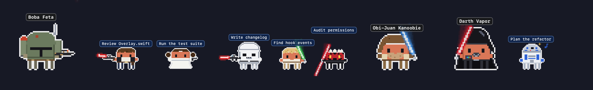
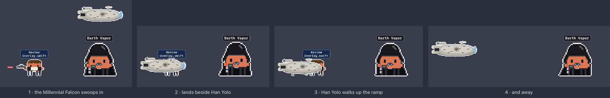
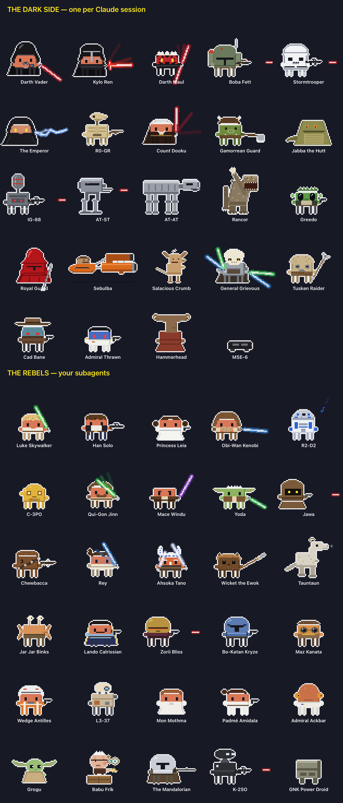
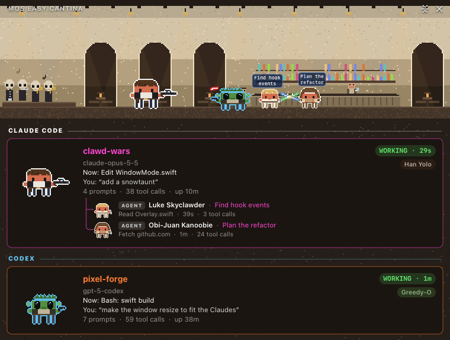
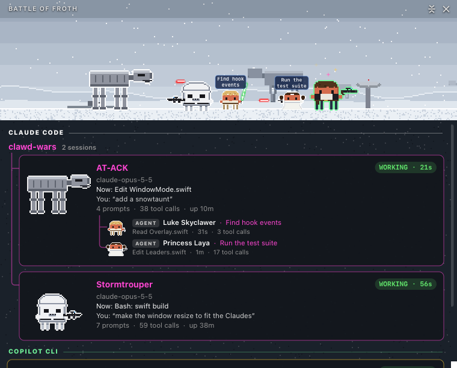
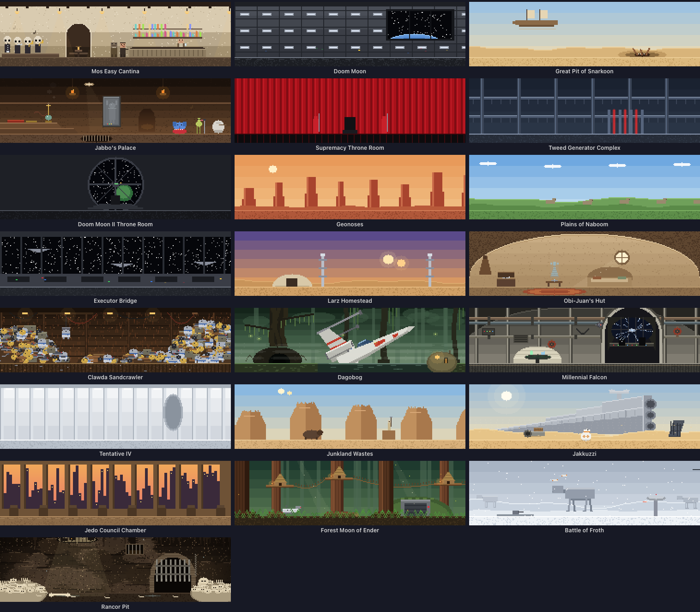
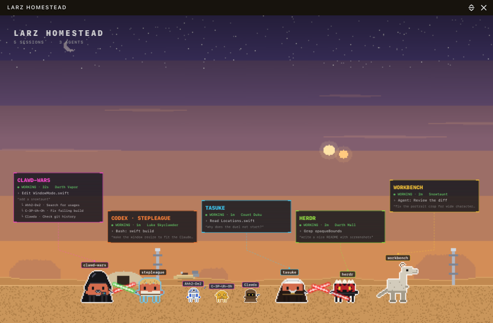
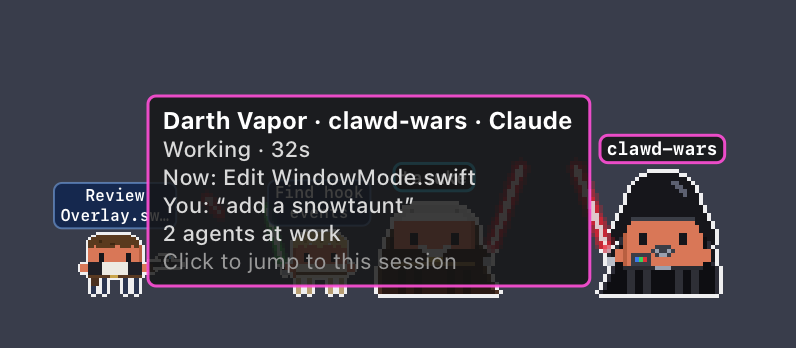

<p align="center">
  
</p>

<h1 align="center">Clawd Wars</h1>

<p align="center">
  <b>Your AI coding sessions, as a pixel-art Star Clawds battle on your desktop.</b><br>
  Every session is a hero or a villain, every subagent joins in, and they fight while they work.
</p>

<p align="center">
  <a href="LICENSE"></a>
  
  
  
  <a href="https://github.com/rodclemen/clawd-clash"></a>
</p>

https://github.com/user-attachments/assets/aff1b2f9-9b96-4dea-8eef-c3f469c93a6b

<p align="center"><sub>🔊 <b>Click the speaker in the player for sound</b>: GitHub starts videos muted. Full 1080p version: <a href="promo/clawd-wars-promo.mp4">promo/clawd-wars-promo.mp4</a></sub></p>

> **Clawd Wars is now part of [Clawd Clash](https://github.com/rodclemen/clawd-clash).** Same crew, same fights, now with two more universes to switch to. This page shows off the Star Clawds universe; see [Get it](#get-it) to install.

<p align="center">
  
</p>

---

## Contents

- [What it is](#what-it-is)
- [The Star Clawds universe](#the-star-clawds-universe)
- [The cast](#the-cast)
- [Window mode](#window-mode)
- [Screen saver](#screen-saver)
- [Get it](#get-it)
- [Two more universes](#two-more-universes)
- [What's new](#whats-new)

## What it is

You run Claude Code in three terminals. One is thinking, one is waiting for your permission, one finished ten minutes ago and you didn't notice. You alt-tab around to find out.

**Clawd Wars tells you at a glance, without switching windows.** Every Claude Code, Codex, Qwen Code, Gemini CLI or GitHub Copilot CLI session becomes a character in a pixel-art Star Clawds battle, along the bottom of your screen or in a window of its own.

- 🗡️ **Working?** Your Claude swings a laser sword (or fires a blaster, or throws dark lightning).
- 💭 **Thinking?** A thought bubble.
- ❗ **Needs you?** A red `!`, and if you ignore it for a minute, it starts jumping up and down. It keeps asking until you answer; press Esc instead and it stands down.
- 😴 **Done and idle?** It stops fighting and passes the time with habits of its own: it looks over its shoulder, lights and spins its sword, or blows the smoke off its blaster. Ahh2-De2 plays Princess Laya's message, C-3P-Uh-Oh throws his arms up, Han Yolo spins his blaster and holsters it, Grogoo eats a cookie, Darth Vapor works his chest panel, a Stormtrouper bumps his head, Kylo Rant throws a tantrum and the Rancor roars. (The Royal Guard doesn't fidget at all.) After a couple of minutes it sits down; after five it's asleep (zZz).
- 🧑‍🚀 **Spawned subagents?** Rebels march in one by one, each labelled with what it's doing, and leave when they finish.
- 🔍 **Hover** any character for the details: status, how long, the tool it's running, your last prompt.
- 🖱️ **Click** any of them to jump straight to that session's terminal or editor tab.

No dashboard to open, no tab to check. It's just… there, quietly having a war.

## The Star Clawds universe

Run two Claudes and they duel. Every character is Clawd (Claude Code's little pixel mascot) in costume, and the fights follow the weapons:

| Matchup | What happens |
|---|---|
| laser sword vs laser sword | they close in and duel; blades clash with sparks |
| blaster vs laser sword | bolts fly, the sword deflects each one off into the sky |
| dark lightning vs laser sword | the blade catches the lightning |
| dark lightning vs blaster | the gunner gets zapped |
| blaster vs blaster | a proper shoot-out: they duck, bolts collide mid-air, shields flash, and bolts ping off armour |
| odd one out | cheers the others on, with sparkles |

Two gunslingers never just shoot each other. Most bolts get saved:

<p align="center">
  
</p>

**Han Yolo shoots first.** Whenever Han Yolo and Greedy-O are both on stage, everyone else shuffles aside so the two of them can face off. Every so often Greedy-O doesn't duck in time: he goes head over heels and lies on his back with stars round his head while Han says *"Sorry about the mess."*, then picks himself up with something to say about it. Jabbo the Glutt laughs at all of it.

**The Millennial Falcon picks Han up.** When Han Yolo's agent is done, he doesn't just fade away: the Falcon swoops in, lands beside him, he walks up the ramp, and it flies off.

<p align="center">
  
</p>

**Light side against dark side.** Run Claude Code alongside Codex, Qwen Code, Gemini CLI or Copilot CLI and they pick sides: whoever was there first keeps theirs, the other takes the opposite, and each one's agents fight for their own side. The outline colour round each character tells you which AI it belongs to.

## The cast

46 villains and 35 heroes, any of whom can be a session (drawn large) or an agent (drawn small).

**The dark side** (Darth Vapor and Kylo Rant never lead back to back): Darth Vapor, Kylo Rant, Darth Mall, Boba Feta, a Stormtrouper, the Emperor, R0-DG3R (*"Roger roger!"*), Count Duku, a Gamoink Guard, Jabbo the Glutt (*"Ho ho ho!"*), IG-Ate-Ate, a Chicken Walker, an AT-ACK, the Rancor, Greedy-O, a Royal Guard, Sebulbous in his pod racer, Salacious Crumble (cackling), General Grievance (four swords), a Tuskin' Raider (always angry), Cad Pain, Admiral Thrown, Hammerhead, Baylan Scowl, Shin Haughty, the Grand Inquisitor and the Second Sister (spinning ring swords), a Banthum, Bib Fortunate, Whatto (*"No credits, no bolts, no bargain!"*), Moff Giddyup (the Dark Blade), a Dearth Trooper, a Scoot Trooper on a speeder bike, Asaj Vengress, Savage Distress, Django Feta, Boss-K, Dangar, a Rolladeka (shield up), Captain Plasma, Director Crankic, Governor Tarquin (*"Fire at will, whenever you like."*), the Fifth Brother and Rava. Mouse-6 and the ID-10T Seeker Bot only ever turn up as agents.

**The light side**: Luke Skyclawder, Han Yolo, Princess Laya, Obi-Juan Kanoobie, Ahh2-De2, C-3P-Uh-Oh, Qui-Gone Tonic, Mace Window, Yodle, a Clawda, Chewbarka, Ray, Asoka Tango, Wicker the Furwok, a Snowtaunt, J.J Blinks, Lando Coolrissian, Zori Blitz, Bo-Kitan Krays, Maz Kanapé, Wedge Antlers, LE-ET (fist up for bot rights), Mon Mothball, Padmé Amidrama, Admiral Snackbar, Grogoo, Babu Flick (sparks flying), the Mandoclawdrian, Kay-2-Snark, Gonky the Power Box, Cassius Andoor (always glancing over his shoulder), Bix Caffeine, Cobb Vance, a Pit Bot (folds up now and then) and Kwill (*"I have spoken."*).

<p align="center">
  
</p>

## Window mode

Clawd Wars opens in a window by default (switch to the desktop from the menu). The whole crew stands in a scene, and every session gets a card: its project, what it's doing right now, your last prompt, its last reply, and its agents in a little tree underneath.

<p align="center">
  
</p>

The scene is set **where the first session's character belongs**: the Doom Moon for Darth Vapor, the Great Pit of Snarkoon for Boba Feta, Jabbo's Palace, the Battle of Froth for the AT-ACK (with more of them marching on the horizon):

<p align="center">
  
</p>

22 hand-built places, each with its own little animation: the band plays in the Mos Easy Cantina while the bartender polishes glasses; Princess Laya's hologram flickers in Obi-Juan's Hut; Clawdas' eyes glow over heaps of junk in the Clawda Sandcrawler; fog drifts over Dagobog; the Millennial Falcon jumps to hyperspace past its cockpit window; a Star Wrecker lies buried in the sand of Jakkuzzi; Furwok lanterns flicker on the Forest Moon of Ender; and Jabbo's court peers down into the Rancor Pit.

<p align="center">
  
</p>

## Screen saver

<p align="center">
  
</p>

Clawd Wars comes with a screen saver: the place at full screen and the crew fighting across its floor. Every Claude and agent wears a name tag, each session has a card floating above the crew, a clock sits in the corner, and what happened lately crawls along the bottom. Every 10 minutes it wipes to somewhere new with a hard edge or a clock wipe. When there's nothing much to watch, it puts on a show instead: a random crew duelling, light side against dark. It even shows your sessions with the app closed.

The window can show the same view, and **Random** location moves the window somewhere new every 10 minutes, with the same wipe.

<p align="center">
  
</p>

## Get it

Clawd Wars is now part of **[Clawd Clash](https://github.com/rodclemen/clawd-clash)**, one app with three universes. It needs macOS 13+ and at least one of Claude Code, Codex, Qwen Code, Gemini CLI or GitHub Copilot CLI.

**With Homebrew**, starting in Star Clawds:

```sh
brew install --cask rodclemen/tap/clawd-wars
```

or the same app under its own name:

```sh
brew install --cask rodclemen/tap/clawd-clash
```

Or download the zip from [Clawd Clash's releases](https://github.com/rodclemen/clawd-clash/releases), unzip it and drag **Clawd Clash** to Applications. Already have the old Clawd Wars app? Clawd Clash takes over its connections and keeps your characters.

Everything else (how it works, the settings, uninstalling, the source and contributing) lives in the **[Clawd Clash repo](https://github.com/rodclemen/clawd-clash)**.

## Two more universes

Star Clawds is one of three. In **Settings → Universe** you can switch to **Marvelous Clawds** or **Detective Clawds**, or pick **Random** to change universe on its own every so often. Switching recasts everyone on screen and moves the scene to one of the new universe's places; a scene never mixes them. See [Clawd Clash](https://github.com/rodclemen/clawd-clash) for the other two casts.

## What's new

The highlights, in plain words: [CHANGELOG.md](CHANGELOG.md). The full history lives in Clawd Clash.

---

<p align="center"><sub>An independent parody fan project, not affiliated with or endorsed by Lucasfilm or Disney. Claude and Clawd belong to Anthropic.<br>Free to use: <a href="LICENSE">MIT licensed</a>.</sub></p>
