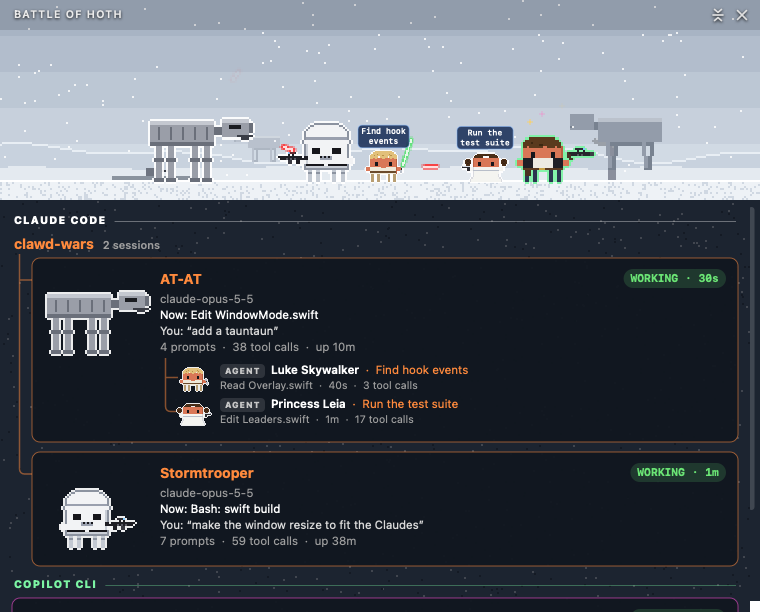

<p align="center">
  
</p>

<h1 align="center">Clawd Wars</h1>

<p align="center">
  <b>Your Claude Code, Codex, Qwen Code, Gemini CLI and Github Copilot CLI sessions, as a pixel-art Star Wars battle on your desktop.</b><br>
  Every session is a hero or a villain, every subagent joins in, and they fight while they work.
</p>

<p align="center">
  <a href="LICENSE"></a>
  
  
  
  
</p>

https://github.com/user-attachments/assets/84cbea65-6fb8-452a-b4d6-811c69c301cc

<p align="center"><sub>🔊 <b>Click the speaker in the player for sound</b> — GitHub starts videos muted. Full 1080p version: <a href="promo/clawd-wars-promo.mp4">promo/clawd-wars-promo.mp4</a></sub></p>

<p align="center">
  
</p>

---

## Contents

- [Why you want this](#why-you-want-this)
- [Claude vs Codex vs everyone](#claude-vs-codex-vs-everyone)
- [The roster](#the-roster)
- [Window mode](#window-mode)
- [Screen saver](#screen-saver)
- [The little things](#the-little-things)
- [Install](#install)
  - [Building from source: what you need](#building-from-source-what-you-need)
- [How it works](#how-it-works)
- [Uninstall](#uninstall)
- [Contributing](#contributing)
- [License](#license)

## Why you want this

You run Claude Code in three terminals. One is thinking, one is waiting for your permission, one finished ten minutes ago and you didn't notice. You alt-tab around to find out.

**Clawd Wars tells you at a glance — without switching windows.**

- 🗡️ **Working?** Your Claude swings a lightsaber.
- 💭 **Thinking?** A thought bubble.
- ❗ **Needs you?** A red `!` — and if you ignore it for a minute, it starts jumping up and down.
- 😴 **Done and idle?** After a couple of minutes it sits down; after five it's asleep (zZz).
- 🧑‍🚀 **Spawned subagents?** Rebels march in one by one, each labelled with *what it's doing* — and they leave when they finish. (When Han's done, the Millennium Falcon lands, he walks up the ramp, and it flies off.)
- 🔍 **Want details?** Hover any character: status, how long, the tool it's running right now, your last prompt.
- 🖱️ **Click any of them** to jump straight to that session's terminal or VS Code tab.

It sits on the bottom of your screen, above every window, and it's click-through everywhere except the characters. No dashboard to open, no tab to check. It's just… there, quietly having a war.

And it's genuinely fun. Run two Claudes and they duel. Spawn a Han Solo and he shoots at Vader, who deflects every bolt into the sky. Put two gunslingers together and it's a proper shoot-out: they duck, bolts collide mid-air, shields flash, and Boba's armour sends shots pinging off into the sky. The Emperor catches Force lightning on Kylo's crossguard. And whenever Han Solo and Greedo are both on stage, everyone else shuffles aside so the two of them can face off. Every so often Greedo doesn't duck in time, and Han shoots first: Greedo goes head over heels, lies on his back with his legs in the air and stars round his head for three seconds while Han says *"Sorry about the mess."*, then picks himself up with something to say about it. Jabba laughs at all of it.

## Claude vs Codex vs everyone

Run **Claude Code** alongside **OpenAI Codex**, **Qwen Code**, **Gemini CLI** or **GitHub Copilot CLI** and they pick sides: whichever was there first keeps its side, the other takes the opposite — Claude has Vader, so Codex gets the heroes — and each one's agents fight for their own side. Light side versus dark side, literally. Close one and everyone's random again.

You can tell the AIs apart at a glance: Claude's characters keep the white outline; Codex gets cyan, Qwen Code lavender, Gemini CLI gold and Copilot CLI mint. In the window's session list, each AI gets its own little section, and Claude Code sessions running inside the **Claude desktop app** are listed separately from the ones in your terminal, with a coral outline instead of white (VS Code ones say so too).

## The roster

Every character is Clawd — Claude Code's little pixel mascot — in costume, drawn in code: no sprite sheets, no image assets (even the app icon is rendered by the same code).

<p align="center">
  
</p>

Anyone can be a session (drawn large) or an agent (drawn small). **The dark side** (Vader and Kylo never spawn back to back): Darth Vader, Kylo Ren, Darth Maul, Boba Fett, a Stormtrooper, the Emperor, R0-GR the battle droid (*"Roger roger!"*), Count Dooku, a Gamorrean Guard, Jabba the Hutt (*"Ho ho ho!"*), IG-88, an AT-ST, an AT-AT, the Rancor, Greedo, one of the Emperor's Royal Guards, Sebulba in his pod racer, Salacious Crumb (cackling), General Grievous (four sabers), a Tusken Raider (always angry), Cad Bane, Admiral Thrawn, Hammerhead, Baylan Skoll, Shin Hati (orange sabers both), the Grand Inquisitor and the Second Sister (spinning ring sabers), a bantha, Bib Fortuna, Watto (*"No money, no parts, no deal!"*), Moff Gideon (the Darksaber), a death trooper, a scout trooper on a speeder bike, Asajj Ventress, Savage Opress, Jango Fett, Bossk, Dengar, a droideka (shield up), Captain Phasma, Director Krennic, Tarkin (*"You may fire when ready."*), the Fifth Brother and Reva. An MSE-6 mouse droid and an ID9 seeker droid only ever show up as agents, never as sessions.

**The light side**: Luke, Han, Leia, Obi-Wan, R2-D2, C-3PO, Qui-Gon, Mace Windu, Yoda, a Jawa, Chewbacca, Rey, Ahsoka, Wicket the Ewok, a tauntaun, Jar Jar Binks, Lando, Zorii Bliss, Bo-Katan Kryze, Maz Kanata, Wedge Antilles, L3-37 (fist up for droid rights), Mon Mothma, Padmé, Admiral Ackbar, Grogu, Babu Frik (sparks flying), the Mandalorian, K-2SO, a GNK power droid, Cassian Andor (always glancing over his shoulder), Bix Caleen, Cobb Vanth, a pit droid (folds up now and then) and Kuiil on his blurrg (*"I have spoken."*).

Blasters are drawn from the film props — Han's DL-44, Leia's Defender, the Stormtrooper's E-11, Boba's EE-3 — and so are the fights:

| Matchup | What happens |
|---|---|
| saber vs saber | they close in and duel; blades clash with sparks |
| blaster vs saber | bolts fly, the saber deflects each one off into the sky |
| Force lightning vs saber | the blade catches the lightning |
| lightning vs blaster | the gunner gets zapped |
| blaster vs blaster | a proper shoot-out — they duck, bolts collide mid-air, shields flash, and bolts ping off armour |
| Han Solo vs Greedo | paired first whenever both are fighting, wherever they are in the line; now and then Han shoots first and Greedo hits the floor |
| odd one out | cheers the others on, with sparkles |

Only Claudes that are working or thinking fight: one that goes idle or is waiting for you steps out a few seconds later, and sits down and falls asleep on the usual schedule. Agents fight as long as they run. Han and Greedo find each other first. Then Claudes fight Claudes, agents fight agents, and leftovers pair up or cheer. R2-D2, C-3PO and the tauntaun stay out of it.

Two gunslingers never just shoot each other — most bolts get saved:

<p align="center">
  
</p>

And when Han Solo's agent is done, he doesn't just fade away — the Millennium Falcon comes to pick him up:

<p align="center">
  
</p>

## Window mode

Clawd Wars opens in a window by default (switch to the desktop from the menu; the crew starts there at the Small size). **Show in Window** puts the whole crew in a scene and gives every session a card, titled with its project (the repo's name when it has a git remote, otherwise the folder's) and a pill saying where the repo lives (GitHub, GitLab, … or Local): what it's doing *right now*, your last prompt, its last reply, how long it's been at it — with its agents hanging underneath in a little tree, each with its task and current tool call. With more than one AI running, every AI gets its own section.

<p align="center">
  
</p>

The scene is set **where the first session's character belongs** — the Death Star for Vader, the sarlacc pit for Boba, Jabba's palace, Hoth for the AT-AT (with more of them marching on the horizon):

<p align="center">
  
</p>

22 hand-built locations, each with its own little animation — Figrin D'an and the Modal Nodes (or, some nights, the Max Rebo Band) play in the cantina while Wuher polishes glasses and Dr. Evazan looks for trouble at the bar; Han hangs in carbonite in Jabba's throne room; Leia's "help me" hologram flickers in Obi-Wan's hut; Jawas' eyes glow over heaps of droid junk in the sandcrawler; Luke's X-wing sinks in Dagobah's bog; the Falcon jumps to hyperspace past its cockpit window; BB-8 rolls past a Star Destroyer buried in Jakku's sand; Ewok lanterns flicker on Endor; AT-ATs march across Hoth; and Jabba's court peers down into the rancor pit:

<p align="center">
  
</p>

Several sessions in the same project are grouped under one project header as a tree, and a card lists four agents with a chevron to unfold the rest (hover any agent in the scene for its details). The window sizes itself to the number of sessions, up to three (more scroll), or keeps your own height, opens as a **Compact Window**, 75% of the full size (a smaller scene and compact cards with normal-size text; turn it off in Settings for full size, and resizing it by hand turns it off too), can hide the session list to become just the scene strip (the button in its title bar), can show the screen saver instead (Settings → Screen Saver View in Window), has a themed title bar with its own close and minimize buttons, can stay on top, and can hide its Dock icon. Project names float over the Claudes on the desktop; in the window the cards carry them instead — each mode remembers your choice. The project you're in (its terminal or editor window in front) has its name 15% larger, there and in the screen saver.

## Screen saver

<p align="center">
  
</p>

Clawd Wars comes with a screen saver: the window's location at full screen and the crew fighting across its floor. Every Claude and agent wears a name tag over its head. Each session has a card floating above the crew, in its project's colour as in the window, with a dashed beam down to its name. The card shows the status (green working, blue thinking, red **NEEDS YOU**, purple asleep), what it's doing, your last prompt and its agents. With many sessions the cards stagger over two rows. A clock sits top right, and what happened lately (finished prompts, agents joining, sessions falling asleep) crawls along the bottom.

Every 10 minutes it does a Star Wars wipe (a hard edge or a clock wipe) to somewhere new: the home of another character on screen, or anywhere if there's only one. Against burn-in, the clock and the place name swap corners at the same time, and the cards and name tags move up clear of where they were. Ten minutes later they go back.

Install it from the menu bar helmet: **Settings → Install Screen Saver…**. That copies it into your `~/Library/Screen Savers` and opens System Settings → **Wallpaper** (on macOS 14 and earlier, **Screen Saver**), where you pick **Clawd Wars** under **Other**. macOS shows a generic swirl for third-party screen savers in that list. After an app update, the installed copy is updated too.

Your sessions show up in the screen saver whether Clawd Wars is open or not: each AI tells Clawd Wars what it's up to as it works, and the screen saver listens in too. With the app open you get everything; with it closed you get nearly everything, minus the news crawl along the bottom.

When there's nothing much to watch, the screen saver puts on a show instead: a random crew of four to six duelling, light side against dark, with a local or two of the place among them, off somewhere new every 3 minutes. That happens when no AI is running, and also when there's just one session sitting idle (one character standing still all night isn't much of a screen saver). As soon as that session gets busy, or needs you, it's back on stage.

**Why a session might not show up with the app closed.** The screen saver only knows about a session once that session has said something. Claude Code checks in the moment you open it. Some AIs stay quiet until you send them a first message; Codex does, for example, and others may too. So a freshly opened Codex appears once you've given it something to do. The same goes for an AI whose connection to Clawd Wars isn't switched on (Codex asks you to approve it once, under `/hooks`). Clawd Wars itself, when it's open, spots every AI as soon as it starts, quiet or not, so with the app running you'll see them all.

And the other way round: when an AI is closed normally it leaves the stage straight away. If it crashes or is force-quit, the screen saver can't always tell right away, so it may linger for a while before it times out.

**Settings → Remove Screen Saver** takes it out again.

The window can show the same view: **Settings → Screen Saver View in Window** (hover a card there to see it larger; the title bar button takes you back). The Location menu's **Random** moves the window somewhere new every 10 minutes, with the same wipe.

## The little things

Hover over anyone for the details — what that session is doing right now, your last prompt, its agents (on the desktop, or in the window when its session list is hidden):

<p align="center">
  
</p>

Forgot one? **Status Symbols** in the menu has the same key, drawn with the app's own sprites.

| You see | It means |
|---|---|
| lightsaber kata | Claude is running tools |
| 💭 thought bubble | thinking |
| red `!` | waiting for your permission — **jumping** after a minute |
| `?` | that session started before the hooks were installed; restart it for live status |
| sitting on the floor | idle for 2+ minutes |
| zZz | idle for 5+ minutes |
| `?` and NOT REPORTING | the hooks stopped reporting for that session while it's clearly busy — restart it |
| `?` and APPROVE IN /hooks | a Codex session is working but its hook hasn't been approved yet — type `/hooks` in Codex and approve Clawd Wars |
| banner + ⚠︎ menu item | an AI on your Mac isn't connected, or one of its sessions isn't reporting; the menu item fixes it (connect, or jump to the session) |
| red OFFLINE banner | the status file can't be read — never silently stale |
| bobbing yellow marker | the Claude whose terminal you're looking at right now |
| matching label colours | a Claude and its agents share their project's colour |
| label above the head | the project (Claudes) or the task (agents) |
| GitHub / GitLab / Local pill | where the project's git remote lives, each host in its own colour (cards in the window); the project is named after the repo, or its folder when there's no remote |

- **Several Claudes at once** — each gets its own villain and project label; sessions that predate the hooks are still found from the process table.
- **Double-click the menu bar helmet** to hide or show Clawd Wars; a single click opens the menu as usual.
- **Settings → Monochrome Menu Bar Icon** swaps the colour helmet for a one-colour one that macOS tints to match the menu bar, like its own icons.
- **Hover** any villain or agent for a details card; agents also show which Claude they work for.
- **Newcomers walk in** from the side of the screen, one at a time, instead of popping up.
- **Drag** the crew anywhere — they'll stand right on the bottom edge of either monitor. Bubbles and labels never go off-screen; if the line is too long, everyone walks over to make room.
- **Click** a villain (or a card) to jump to the session: the exact tab in Terminal or iTerm2, or the right window — even the right *native tab* — in VS Code or Cursor.
- **Menu bar helmet** and right-click give you everything: status, Hide/Show Clawd Wars, Show in Window, Location, Settings. Hold **⌘** for the Playground (put any villains and heroes on stage and watch them fight) and Demo Mode.

## Install

Needs macOS 13+ (Apple Silicon or Intel) and at least one of [Claude Code](https://claude.com/claude-code), [Codex](https://developers.openai.com/codex) [Qwen Code](https://github.com/QwenLM/qwen-code), [Gemini CLI](https://github.com/google-gemini/gemini-cli) or [GitHub Copilot CLI](https://github.com/github/copilot-cli). Clawd Wars asks before connecting any of them, and only touches the ones you connect (`~/.claude/settings.json`, `~/.codex/hooks.json`, `~/.qwen/settings.json`, `~/.gemini/settings.json`, `~/.copilot/hooks/clawd-wars.json`).

> Google's newer **Antigravity CLI** (`agy`) isn't supported yet: its hooks have to answer some events with decisions, which needs testing against a real install first.

> **Codex users:** Codex only runs hooks you've approved. After installing, run **`/hooks`** in Codex once and approve the Clawd Wars hook — until then your Codex sessions still show up, but with a `?` instead of live status. You don't have to remember: when a Codex session starts working without reporting, Clawd Wars sends a notification telling you to approve it (click it to jump to that session).

Clawd Wars only checks the AIs actually on your Mac. If one is installed but not connected (say you install Codex later), you get a banner and a **⚠︎ Connect Codex…** item at the top of the menu, and the app offers to connect it on next launch. Don't use it with Clawd Wars? Click the **×** on the banner (or **Don't Remind Me About …** in the menu) and it stops asking; you can still connect it later from Settings.

**With Homebrew** (easiest):

```sh
brew install --cask rodclemen/tap/clawd-wars
```

Or download the zip from [Releases](https://github.com/rodclemen/clawd-wars/releases), unzip it and drag **Clawd Wars** to Applications. On first launch it offers to connect every supported AI it finds — Claude Code, Codex, Qwen Code, Gemini CLI, Copilot CLI — adding a small hook to each one's settings and keeping a backup.

**From source:**

```sh
git clone https://github.com/rodclemen/clawd-wars.git
cd clawd-wars
./build.sh            # build, install "Clawd Wars.app" to /Applications, refresh the hooks of AIs you've connected, launch
./build.sh --no-hooks # the same, but leave every AI's settings alone
./build.sh --no-install # build and run the copy in build/: nothing goes into /Applications, no AI's settings change
```

> **Don't want to run a prebuilt app?** Build it yourself. You don't need Xcode, only Apple's free Command Line Tools:
>
> ```sh
> xcode-select --install     # one time: a macOS dialog installs the tools
> git clone https://github.com/rodclemen/clawd-wars.git && cd clawd-wars
> ./build.sh --no-install    # compiled on your Mac from the source you can read, and run from build/
> ```
>
> Nothing is installed and no AI's settings change until you connect one from the app's menu. If you do connect from the `build/` copy, the hooks point into `build/`: rebuilding replaces that folder (sessions miss a few seconds of updates), and deleting it leaves the hooks pointing at nothing (remove them first with Settings → Remove … Hooks). When you're happy with it, `./build.sh` installs it to /Applications and points the connected hooks there.

Claude Code sessions that were already running pick up the hooks after a restart (`/exit`, then `claude --continue`). Until then they still show up — as a villain with a `?`.

Clicking to jump to a session in Terminal or iTerm2 asks once for **Automation** permission (Apple Events) to control that terminal; jumping to an editor (VS Code, Cursor) asks once for **Accessibility** permission.

### Building from source: what you need

There are no packages to install: no Homebrew, SwiftPM, CocoaPods or Xcode project. `build.sh` calls `swiftc` directly and uses only tools that come with macOS or Apple's developer tools.

| Need | Why | Check | Get it |
| --- | --- | --- | --- |
| macOS 13 or later | the app's deployment target | `sw_vers` | — |
| Swift 6.2 or later (Swift 5 language mode) | compiles everything | `swiftc --version` | `xcode-select --install` (Command Line Tools) **or** Xcode from the App Store. Either works: Xcode isn't required. |
| `lipo`, `codesign`, `sips`, `tiffutil`, `iconutil`, `security` | universal binaries, signing, icon and screen-saver thumbnail | `which lipo codesign` | `lipo` comes with the developer tools above; the others ship with macOS |
| `zsh` | `build.sh` is a zsh script | — | macOS's default shell |

Tested with Swift 6.2.3 (Command Line Tools 26.2) and Swift 6.3.3 (Xcode 26.6) on macOS 26, on Apple Silicon. A local build compiles for your Mac's architecture only; `--release` builds a universal binary and needs a **Developer ID** certificate (only the maintainer needs that).

**Signing.** You don't need an Apple developer account. `build.sh` signs with any `Apple Development` or `Developer ID` identity in your keychain, and falls back to ad-hoc signing (it prints `signed with: ad-hoc`). That works fine, with one catch: macOS forgets an ad-hoc app's **Accessibility** permission every time you rebuild, so jumping to VS Code or Cursor asks again after each `./build.sh`. Signing in to Xcode with a free Apple ID (Xcode → Settings → Accounts) creates an Apple Development identity and avoids this.

**If the build fails:**

- **`xcrun: error: invalid active developer path`** or **`swiftc: command not found`**: no developer tools are installed. Run `xcode-select --install`.
- **`You have not agreed to the Xcode license agreements`**: you just installed or updated Xcode. Run `sudo xcodebuild -license accept`, or open Xcode once.
- **The wrong toolchain is being used** (for example, an old Xcode after installing a new one): `xcode-select -p` shows which one is active and `swiftc --version` shows its Swift version. Switch with `sudo xcode-select -s /Applications/Xcode.app` or `sudo xcode-select -s /Library/Developer/CommandLineTools`.
- **`the compiler is unable to type-check this expression in reasonable time`**, followed by a string of other errors in the same file (`cannot infer contextual base…`, `cannot infer key path type…`, `binary operator '*' cannot be applied to operands of type 'Float16' and 'Double'`): this is a bug in Clawd Wars, not in your setup. All the pixel art is written as long numeric expressions, and an expression whose types aren't stated can exceed the type checker's limits. That limit is fixed, not timed, so a faster Mac or a retry won't get past it. Only the first error matters; the rest follow from it. The fix is to state the type, for example `[0xFF8A3D, …] as [Int]` or `let a: Double = …`. Please open an issue with your `swiftc --version`.

## How it works

- A tiny Foundation-only binary, `clawd-wars-hook`, is registered in `~/.claude/settings.json` for Claude Code's hook events (session start/end, prompts, tool calls, permission requests, subagents, stop). It writes `~/.claude/vader-status/state.json` under a file lock and exits silently — it can never get in Claude's way.
- It records what each session is doing: its state and since when, the current tool call (`Edit Overlay.swift`, `Bash: swift build`), your last prompt and Claude's last reply, the model and session title, and each subagent's task.
- The app reads that twice a second, finds sessions without hooks from the process table, and drops a session the moment its process exits.
- Everything you see — characters, weapons, effects, 22 locations, the icon — is pixel art drawn in Swift at runtime. `Tools/RenderDocs` renders the roster and location sheets above; `CLAWD_SHOT=/path.png` makes the app dump its own frames.
- The first install backs up your settings to `~/.claude/settings.json.before-vader` (other AIs get a `.before-clawd-wars` copy next to their file).
- The hooks point at the app by its full path. Move the app and, the next time it launches, it re-points any hook whose binary is gone at its new location (Codex then asks you to approve it again in `/hooks`).

## Uninstall

With Homebrew: `brew uninstall --cask clawd-wars` (removes the hooks too; add `--zap` to also remove its settings and status file).

Otherwise: menu bar helmet → **Settings → Remove … Hooks** for each connected AI, then **Quit**. Or remove them all at once from the terminal, then delete the app:

```sh
"/Applications/Clawd Wars.app/Contents/MacOS/ClawdWars" --uninstall-hooks
rm -rf /Applications/"Clawd Wars.app" ~/.claude/vader-status
```

## Contributing

New characters and locations are very welcome — everything is pixel art drawn in code, so there are no assets to wrangle:

- **A villain:** add a case at the end of `Leader` in `Sources/App/Leaders.swift` (name, weapon, head height) and a `draw…` costume function (newer ones live in `Sources/App/Recruits.swift`); give it a home in `Location.home(of:)`.
- **A hero:** add a case at the end of `Companion` in `Sources/App/Characters.swift` and its drawing; a home in `Location.home(of:)`.
- Always add at the end: the ids are saved, so reordering would swap everyone's characters. A character that should only ever be an agent goes in `StatusStore.agentOnly`.
- **A location:** add a case to `Location` and a scene in `Scenes` (`Sources/App/Locations.swift`), with an optional animated layer.
- Bump `leaderCount` / `companionCount` in `Sources/Shared/StatusStore.swift`.
- Check it: hold ⌘ and open the menu for the **Playground**, or run `CLAWD_SHOT=/tmp/shot.png` with `--playground=…` / `--agents=…`. Regenerate the README sheets with `Tools/RenderDocs`.

Issues and pull requests are open — say which character you'd like next.

## License

**Free to use.** The code is [MIT licensed](LICENSE): use it, change it, share it, ship it — just keep the license notice.

---

<p align="center"><sub>A fan project. Star Wars and its characters belong to Lucasfilm/Disney; Claude and Clawd belong to Anthropic.<br>Not affiliated with or endorsed by either.</sub></p>
